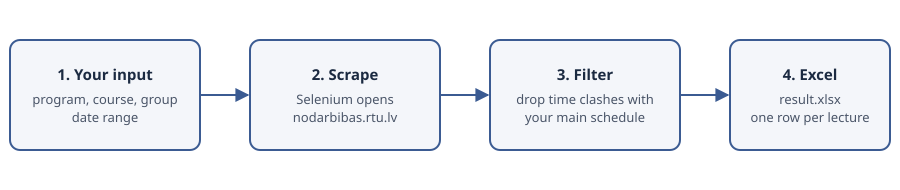

# RTU program parser

Part of my portfolio: https://ilyaeis.github.io



A study project (Riga Technical University, Data structures and algorithms, 2 authors). It finds extra lectures that fit your own timetable.

## English summary

This tool finds extra lectures at Riga Technical University (RTU) that fit your own timetable. It scrapes <https://nodarbibas.rtu.lv> with Selenium, drops every lecture that clashes with your main schedule, and writes the remaining options to an Excel file.

### How it works

1. You set your program, course and group in `input_data` in `main.py`.
2. Selenium opens the RTU timetable site. The tool reads your main schedule and the schedules of all other programs.
3. It drops a lecture if it clashes with your main schedule, repeats a lecture you already have, or only fits in part (one of its weekly slots clashes).
4. It writes the lectures that pass to `result.xlsx`. You then filter the table in Excel by week, day, time or name.

### Example result

From `examples/result.xlsx` (286 extra lectures, made by [`docs/make_table.py`](docs/make_table.py) with pandas, no scraping). RTU has a two-week schedule.

Lectures per day:

| Diena       |   Pirmā nedeļa |   Otrā nedeļa |
|:------------|---------------:|--------------:|
| Pirmdiena   |             14 |            13 |
| Otrdiena    |             37 |            28 |
| Trešdiena   |              9 |             7 |
| Ceturtdiena |             47 |            41 |
| Piektdiena  |             45 |            45 |

First rows of the table:

| Nedeļas kārta   | Diena     | Laiks         | Nosaukums                                    |   Grupu skaits |
|:----------------|:----------|:--------------|:---------------------------------------------|---------------:|
| Otrā nedeļa     | Pirmdiena | 16:30 - 18:05 | Banku informācijas sistēmas                  |              2 |
| Otrā nedeļa     | Pirmdiena | 16:30 - 18:05 | Dabiskās valodas apstrāde                    |              1 |
| Otrā nedeļa     | Pirmdiena | 16:30 - 18:05 | Datorsistēmu projektēšanas pamati            |              1 |
| Otrā nedeļa     | Pirmdiena | 16:30 - 18:05 | Drošas datortīklu sistēmas                   |              1 |
| Otrā nedeļa     | Pirmdiena | 16:30 - 18:05 | Elektrostaciju un apakšstaciju ekspluatācija |              2 |

### Requirements

- Python 3.9+
- Google Chrome. Selenium opens it through `webdriver.Chrome()`. Selenium 4.6+ downloads the matching driver by itself.
- `pip install -r requirements.txt` (selenium, pandas, openpyxl). `docs/make_table.py` also needs `tabulate`.

### Inputs

Edit the `input_data` dictionary at the bottom of `main.py`: your program, course and group IDs, the range of programs to search, and the range of dates (two full weeks). The comments in the file explain how to find the IDs with the browser "inspect" tool.

### Run

```
python main.py
```

The program writes `all_possible_additional_lectures.json` (intermediate data) and `result.xlsx` (final list) into the current folder. Press Enter in the terminal at the end to close the browser.

### Examples

`examples/` holds a sample `main_schedule.json` and a sample `result.xlsx`.

---

## Latvian course description

# Datu strukturas un algoritmi - gala projekts
## Ilja Safronovs un Aleksejs Peņkovs, RDCM0, 1. kurss, 15. grupa
### Automatizētā papildus lekciju mēklēšana
#### Ko dara musu programma?
  Musu jaunizveidota programma palīdz mums automatizēt papildus lekciju mēklēšanu RTU ietvaros, kas patiesībā ir diezgan sarežģits darbs. Protams, tas nav ikdienas problema, tomēr reizi pusgadā, kad katrai grupai tiek veidots jauns lekciju saraksts, mes atkal saskaramies ar vajadzību mēklēt jaunās studiju iespējas, jo esam aktīvi cilvēki un mēģinam daudzpusīgi attistīties. Tā kā tas ir laika un resursu ziņā ļoti apjomigs darbs, mes izvēlējamies tieši šo procesu musu automatizācijas projekta izstrādē.

  Ar musu koda palidzību ikviens lietotājs var atrast sev piemērotas papildus lekcijas RTU ietvaros. Sākumā ir jādefinē savu pamatsarakstu, lai papildus lekcijas neskartu un netraucētu pamatmācības, un tad programma izveidos sarakstu ar visiem pieejamiem papildus kursu variantiem. 

  Tas ļoti atvieglo musu darbu, jo katru reizi manuāli pārskatīt katru studijas virzienu, gadu un grupu visās fakultātēs tiešām ir milzigs darbs. Savukārt musu programma ļauj lietotājam uzreiz dabūt filtrētu sarakstu tikai ar derīgiem lekciju variantiem. Tad jau manuālā režimā katrs lietotājs var iziet cauri salīdzinoši mazam sarakstam un ātri izvēlēties finala variantu.
### Kā darbojas musu programma?
  Sākuma lietotājam ir jāievada nedaudz informācijas par savu grupu un mēklēšanas diapazonu, lai programma varetu izgūt no nodarbibas.rtu.lv lietotāja pamatsarakstu un veselu kaudzi ar papildus lekcijam. Tad programma automatiski pārmēklēs visas lekcijas un atradīs tadas, kuras atbilst šādiem kritērijiem:
- lekcija netraucē pamatmācībam, kas ir papildus lekcijas laiks nesakrīt ar pamalekciju laikiem;
- lekcija atšķiras no lietotāja pamatsaraksta (jo nav jēgas atkartoti apmēklēt tadas pašan nodarbības);
- visas nodarbības tajā priekšmetā ir pieejamas apmeklēšanai, jeb neviena no nodarbībam nedeļas griezumā nepārklājas ar lietotāja pamatsarakstu (jo nav jegas tikai daļēji apgūt lekciju materiālu).

  Ja lekcija neatbilst kaut vienam no kritērijiem, tā netiek atzīta par derīgu, savukārt, jā lekcija visiem kritērijiem atbilst, tā tiek ierakstīta Excel failā tabulas veidā. Tad jau manuālā režīmā lietotājs ar parasto filtru izmantošanu ātri un vienkārši var atlasīt pēc nedeļam (jo RTU ir 2 nedeļu grafiks), dienam, laikam, grupu skaita un nosaukuma, lai izvēlēties sev visatbilstošāko. Protams, tabulā tiek attēlota 1 grupa, kurai sarakstā ir šāda lekcija, lai lietotājs varētu pārbaudīt lekcijas esamību reālajā sarakstā un pārliecināties musu programmas pareizībā.
### Kādas bibliotēkas tika izmantotas musu programmā un kāpēc?
- "selenium", lai emitēt lietotāja uzvēdību nodarbibas.rtu.lv mājaslapā;
- "json", lai saglabat datus .json failā un izmantot to talākai apstrādei;
- "time", lai veidot pauzes starp pieprasījumiem no tīmekļa vietnes un nepaaugstināt dažādu kļudu risku;
- "datetime", lai operet ar datumiem un laikiem lekciju apstrādes un filtrēšanas procesā;
- "pandas", lai sagatavot gala rezultātu tabulas formatā un ierakstīt to Excel failā.
### Kādas datu struktūras tika izmantotas musu programmā un kāpēc?
- Galvenā datu struktūra ir "dictionary", lai saglabat datus vairakās dimencijās, kārtojot pēc nedeļam, dienam, laikiem, lekciju nosaukumiem, grupam un citiem parametriem, jo dictionary stradā uz {key: value} struktūras, kas palīdz vieglāk sagalabāt datus un operēt ar tiem;
- "pandas.DataFrame", lai atvieglot tabulas veidošanas procesu un vieglāk parnest datus uz Excel failu;
- Protams tika izmantotas citas datu struktūras, piemēram, masīvi.
### Kopsavilkums
  Programma der visiem RTU studentiem un stradās līdz brīdim, kad nodarbibas.rtu.lv nomainīs lietotnes izkārtojumu vai struktūru. Pati programma aizņēm daudz laika īstenošanas procesā, tomēŗ tā tiešām ļoti atvieglo papildus lekciju mēklēšanas procesu, jo lietotājam vajag iedot programmai pavisam nedaudz informācijas un vienkārši uzgaidīt kādu laiku. Izstrādes procesā tika izmantotas zināšanas, kuras tika iegūtas RTU lekciju laikā, kā arī salīdzinoši neliela AI palīdzība.
